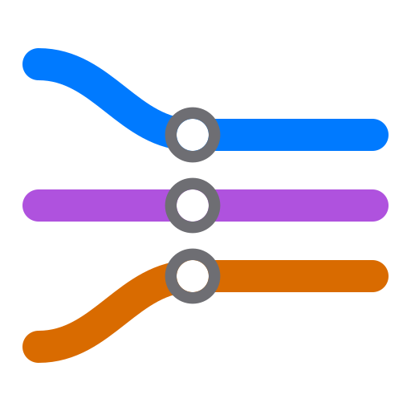

# HeddleFlow

**HeddleFlow works with AI agents to build a new product from an idea, or grow an existing one from a change, through
to release.**

HeddleFlow is a framework. It installs into your project, for the harness you already use, and sets the order of the
work: AI agents do the writing and the building, an independent review checks everything they produce, and checks
enforce what an instruction alone cannot. You decide where it matters.

> **Status: in development, with no public release yet.** This repository receives HeddleFlow's releases as they are
> made public. Until the first one, §Installing describes the route it will take, and this page says so wherever a
> part is not built.

## Where it runs

HeddleFlow targets six harnesses, each on macOS, Windows and Linux. Where each one runs HeddleFlow today, on macOS,
in its vendor's cloud, and in a project's CI on Linux and Windows:

| Harness | CLI | Editor (its own, a VS Code extension, or in VS Code's chat) | Desktop app | Cloud agent | CI |
|---|---|---|---|---|---|
| Claude Code | Yes | Yes ³ | Not yet | Yes | Not yet |
| GitHub Copilot | Yes | Not yet ² | Not yet | Not yet | Not yet |
| OpenAI Codex | Yes | Yes ³ | Not yet | Not yet | Yes |
| Cursor | Yes | Yes | Not yet | Not yet | Not yet |
| Google Antigravity | Partial ¹ | Partial ¹ | Not yet | — | Not yet |
| OpenCode | Yes | Not yet | Not yet | — | Yes |

*Yes*: runs, every check passed. *Partial*: runs with less. *Not yet*: still to run. *—*: the harness has no such
surface. ¹ Antigravity serves no MCP server from a project, so its agent reaches HeddleFlow's tools through the shell.
² VS Code now runs Copilot on its own Copilot harness, on which HeddleFlow is yet to run. ³ In its VS Code extension;
in VS Code's own chat, where VS Code hosts it, it is yet to run. On Windows and Linux, every test and the build pass in
CI, and Codex and OpenCode have run HeddleFlow there.

## Installing

Once the first release is public:

1. Install Git, [uv](https://docs.astral.sh/uv/) and your harness.
2. In a terminal, in your project's folder, run:

   ```
   uv run https://github.com/HeddleFlow/HeddleFlow/releases/latest/download/HeddleFlow.zip install claude
   ```

   Name every harness you use: `claude`, `copilot`, `codex`, `cursor`, `antigravity`, `opencode`. From any other
   folder, add `--into <your project's folder>`.
3. Commit `.heddleflow/` and the files it placed.
4. Add `uv run .heddleflow/hdf.py doctor --check` to your project's CI, so a generated file nobody regenerated never
   merges.

The release installs itself: it unpacks into your project as `.heddleflow/`, and installs the harnesses you name from
there. HeddleFlow lives in your project, in `.heddleflow/`, and each harness reads the files it placed in that harness's
own folders, so every clone of the project runs the same version. Nothing of HeddleFlow's is installed on your machine.

**Your own instructions for every agent go in `PROJECT.md`, at your project's root.** HeddleFlow writes `AGENTS.md`,
which every harness reads, from its own rules and your `PROJECT.md`, and, with Claude Code, a `CLAUDE.md` that points to
it; never edit either by hand. Text your project already had in `AGENTS.md` moves into `PROJECT.md` when you install,
and its `CLAUDE.md` text too when you install for Claude Code.

To update: `uv run .heddleflow/hdf.py update`, which shows what each newer release brings and asks before it changes
anything; `update --check` only shows it. Each release's notes are on its page under this repository's releases. To
check for drift: `uv run .heddleflow/hdf.py doctor`. Your agent runs these too: ask it to add a harness or update
HeddleFlow.

## Independence

HeddleFlow is a personal project of Vikas Burman, developed independently, on personal time and with personal
resources. It is not affiliated with, sponsored by or endorsed by any current or former employer or client of the
author, and nothing in this repository represents their views or positions.

HeddleFlow is not affiliated with or endorsed by Anthropic, GitHub, Microsoft, OpenAI, Anysphere, Google or the makers
of OpenCode. Claude Code, GitHub Copilot, OpenAI Codex, Cursor, Google Antigravity and OpenCode are trademarks of their
respective owners, named only to say where HeddleFlow runs.

## Contributing

**HeddleFlow is open source, but not open development**: it is built in a private repository and each release is
published here, so this repository takes no pull requests. Report a bug or suggest an improvement as an issue, with
its form; [`CONTRIBUTING.md`](CONTRIBUTING.md) says how. Security problems are reported privately, as
[`SECURITY.md`](SECURITY.md) says.

## Licence

Apache License 2.0; see [`LICENSE`](LICENSE) and [`NOTICE`](NOTICE).

HeddleFlow™ and the HeddleFlow name are trademarks of Vikas Burman. The licence grants no right to use them, so a
modified version or a fork is distributed under a name of its own; [`NOTICE`](NOTICE) says so in full.
